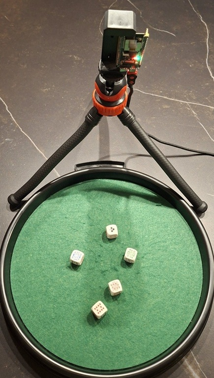
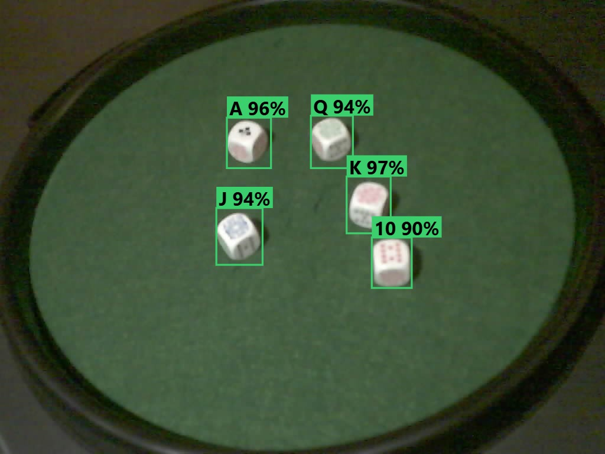

# ESP32-S3-PokerdiceAI

**Poker dice recognition on an ESP32-S3 camera board - on the device, without a cloud.**
The board looks at the dice tray, finds the five dice, reads the symbol on top of each (9, 10, J, Q, K, A) and
shows the poker hand on its own web page: *One Pair*, *Full House*, *Five of a Kind* …

It comes in two parts:

- **Firmware** for an ESP32-S3 camera board: object detection and classification with
  [ESP-DL](https://github.com/espressif/esp-dl), web page with live image and boxes, history, monitoring.
  Example models are included, so you can build and flash it right away.
- **Trainer** for your own dice: a step-by-step web program on your computer. You photograph your die, your tray
  and a few real throws; Google Colab renders thousands of synthetic training images with Blender and trains the two
  small networks; the trainer converts them for the ESP32 and puts them into the firmware.

<p>
  
  
</p>

## How it works

```
camera JPEG ──► detector (ESPDet-Pico, 224 px) ──► one box per die
            └─► crop around every die ──► classifier (small CNN, 64 px) ──► symbol per die, "?" if unclear
                                          ──► stable over a few frames ──► poker hand ──► web page, LED
```

Everything runs on the ESP32-S3 (two int8 networks, about 0.8 MB together). The trainer and Colab are only needed to
train models for **your** dice.

## Hardware

Target board: **ESP32-S3-CAM** (ESP32-S3-WROOM-1 **N16R8**: 16 MB flash, 8 MB octal PSRAM) with an **OV3660** camera.
The camera pins are the same as on the Espressif ESP32-S3-EYE, which many ESP32-S3 camera boards copy:

| Signal | GPIO | Signal | GPIO |
|---|---|---|---|
| XCLK | 15 | PCLK | 13 |
| SIOD (SDA) | 4 | VSYNC | 6 |
| SIOC (SCL) | 5 | HREF | 7 |
| D7 / Y9 | 16 | D3 / Y5 | 10 |
| D6 / Y8 | 17 | D2 / Y4 | 8 |
| D5 / Y7 | 18 | D1 / Y3 | 9 |
| D4 / Y6 | 12 | D0 / Y2 | 11 |
| PWDN, RESET | – | RGB LED (WS2812) | see `firmware/main/boards/esp32s3_cam.h` |

Other boards: copy `firmware/main/boards/esp32s3_cam.h`, adapt the pins and include it in `firmware/main/board.h`.
At least 8 MB flash and PSRAM are needed.

## Quick start A: flash the firmware with the example models

You need [ESP-IDF 6.x](https://docs.espressif.com/projects/esp-idf/en/latest/esp32s3/get-started/) (or VS Code with the
ESP-IDF extension).

```
cd firmware
idf.py set-target esp32s3
idf.py build flash monitor
```

The models in `firmware/models/` are flashed into their own partitions. Then:

1. Join the board's Wi-Fi hotspot **Pokerdice** (password `pokerdice` - please change it in
   `firmware/main/wifi_config.h`). The page opens by itself, otherwise open http://192.168.4.1.
2. Tab **Wi-Fi**: join your home network if you like - the board is then at http://pokerdice.local.
3. Tab **Play**: roll the dice.

The example models know **the dice, the tray and the camera position they were trained for** (shown in the images
above). With other dice, train your own (quick start B).

More: [docs/firmware.md](docs/firmware.md).

## Quick start B: train models for your own dice

You need Python 3.11, a Google account (Colab, free or paid GPU time) and optionally an
[Anthropic API key](https://console.anthropic.com/) for the AI helpers of the trainer.

```
# Windows (PowerShell, in the repository folder)
powershell -ExecutionPolicy Bypass -File setup.ps1
start.bat

# Linux / macOS
./setup.sh
./start.sh
```

The trainer opens in the browser and leads through all steps: camera setup, measuring and photographing the die,
tray and felt, Colab package, real test throws, converting the models and copying them into the firmware.

| Document | Content |
|---|---|
| [docs/getting_started.md](docs/getting_started.md) | installation, first start, where your data lives |
| [docs/trainer.md](docs/trainer.md) | the steps of the trainer |
| [docs/colab.md](docs/colab.md) | rendering and training in Google Colab |
| [docs/convert_and_flash.md](docs/convert_and_flash.md) | from the Colab export to the flashed board |
| [docs/firmware.md](docs/firmware.md) | firmware: Wi-Fi, LED, web page, API, other boards |
| [docs/use_models_in_your_firmware.md](docs/use_models_in_your_firmware.md) | the models in your own firmware |

## Repository

```
setup.ps1, setup.sh  create the Python environment .venv for the trainer
start.bat, start.sh  start the trainer
docs/                documentation
firmware/            ESP-IDF project (C/C++), web page in firmware/main/web/index.html
  models/            dice_det.espdl, dice_cls.espdl, model_config.h - the models that are flashed
  tools/             web_preview.py (page on the PC without board), test_pc/ (pre-/post-processing vs. Python)
trainer/
  assistant/         the trainer (Flask web program)
  colab/             scripts and notebooks for Google Colab (Blender rendering, training, export)
  convert/           conversion for the ESP32 (esp-ppq), select_project.py
  tools/             evaluation of the test images, photo metadata removal
workspace/           your projects (created on the first start, not part of the repository)
```

## Privacy and secrets

- The Anthropic API key is stored only in `~/.pokerdice/api_key.txt` (or the environment variable `ANTHROPIC_API_KEY`),
  never in the repository, in Colab packages or in the firmware.
- Wi-Fi passwords are stored only on the board (NVS), never in the code.
- Your photos and projects stay in `workspace/`, which git ignores. Colab packages contain your photos - they go to
  your own Google Drive only.

## License

[GNU Affero General Public License v3.0](LICENSE). This program is distributed **without any warranty** - see the license.

Third-party parts used by this project keep their own licenses, among them: ESP-IDF (Apache-2.0),
ESP-DL (MIT), esp_new_jpeg (Espressif MIT), esp32-camera (Apache-2.0), mDNS (Apache-2.0), esp-ppq (Apache-2.0),
esp-detection / ESPDet-Pico and Ultralytics (AGPL-3.0), Blender (GPL, used as a program in Colab).
